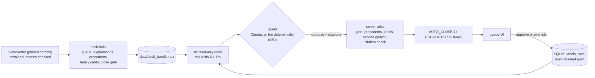

# FlowSentry Desk

**A triage agent for the network flows FlowSentry refuses to call. Six read-only tools, a memo where every claim cites
evidence the server issued, and a close that needs three independent yeses.**

Built for Build North 2026 (Georgian) on top of my open-source detector
[FlowSentry](https://github.com/Aeripsen/flowsentry). What existed before Build Week and what is new is in
[PRIOR_WORK.md](PRIOR_WORK.md).

## The problem, in one queue

FlowSentry is a UDP/QUIC intrusion detector that is allowed to say "I don't know". At its 0.99 confidence bar it
refuses 2,315 of its 6,570 held-out flows and sends them to an analyst. In that queue, 1,824 flows (78.8%) are
benign, 144 are UDP-RAW floods and 347 belong to six rare flood families. The analyst spends the shift closing benign
flows, and the rare floods hide among them.

The 78.8% is a property of FlowSentry's committed sample, which caps benign traffic. On a real network the queue would
be far more benign, which makes the analyst's day worse, not better.

## What the desk does

1. **Pre-reads each case with six read-only tools.** `next_case` (FlowSentry's verdict, confidence and key flow
   statistics next to typical benign values), `explain` (the exact path contributions of the FlowSentry forest that
   answered this flow: base rate plus contributions equals FlowSentry's probability, checked to 1e-6),
   `precedents` (the 15 nearest labelled flows from the training split), `family_card` (what an attack family looks
   like in training data, its ATT&CK technique and playbook), `second_opinion` (a small model trained only on this
   analyst's labels) and `propose`. No tool writes anything, blocks traffic or reaches the network.
2. **Cites everything.** Each tool result gets an id (R1, R2, ...) that only the server issues. The memo must cite them
   inline; an id that was not issued in that run is refused, and a memo that never passes goes to a person.
3. **Proposes, never decides.** The agent proposes close, escalate or ask a human. A case closes only if the agent
   proposes a close, the server rules allow it, and the citations check out. The rules: a calibrated close gate
   (trained on training data only) clears the flow, at least half of its 15 precedents are benign, no flow the analyst
   labelled as an attack sits in its neighbourhood, and the second opinion does not object. The agent cannot see the
   gate. It can add human attention, never remove it.
4. **Has a close knob.** Like FlowSentry's reject knob, the analyst picks a cap on attacks wrongly closed per 1,000
   closed. Each cap maps to a gate threshold certified on training data (95% Wilson upper bound). The default is the
   strictest cap the training data can certify.
5. **Learns from the analyst, in the safe direction.** Labels train the second opinion and feed the nearby-attack
   rule, so an override can only make the desk more careful near that flow. After each label the desk reports which
   nearby cases it would now handle differently.
6. **Keeps a tamper-evident audit log.** Every run, label, reopen and knob change is a row that stores the hash of the
   row before it; the Audit view re-checks the whole chain. Each analyst works a separate workspace (their Clerk user
   when sign-in is on, a random browser id otherwise).

## Results

Measured once on the 2,315-flow queue, with an oracle analyst that answers with the dataset's label. Everything below is
in [reports/eval.json](reports/eval.json) and is rebuilt by `make eval`. The engine is the deterministic policy; a
model-driven run can only close a subset of what the policy closes, because a close needs the same server rules.

**The close knob.** Caps are certified on training data; the test queue was scored once at every setting.

| Cap (certified on training) | Certified | Queue closed | Attacks closed | Per 1,000 closed (95% CI) | Queued attacks closed | Decisions per 100 |
|---|---|---|---|---|---|---|
| 10 per 1,000 | no | 0% | 0 | n/a | 0% | 100 |
| **20 per 1,000 (default)** | yes | **2.5% (58)** | **0** | **0 (0 to 62.1)** | **0%** | **97.5** |
| 30 per 1,000 | yes | 13.7% (318) | 4 | 12.6 (4.9 to 31.9) | 0.8% | 86.3 |
| 50 per 1,000 | yes | 17.4% (403) | 8 | 19.9 (10.1 to 38.7) | 1.6% | 82.6 |
| 100 per 1,000 | yes | 73.9% (1,711) | 148 | 86.5 (74.1 to 100.8) | 30.1% | 26.1 |

The default is strict: it closes few flows, none of them attacks, and 58 closes are too few to bound the rate tightly
(the interval runs to 62 per 1,000). At 30 per 1,000 the desk closes 13.7% of the queue; the four attacks it closes
there are 2 UDP-bypass-v1, 1 UDP-MULTI and 1 UDP-VSE flow. At every setting, 8.0 of the remaining decisions per 100
items are one-key confirmations of an escalation rather than full investigations.

**Finding attacks sooner.** In the desk's order (least benign-looking first), an analyst finds half of the 491 queued
attacks after 325 items, against 866 in FlowSentry's own order (lowest P(benign) first) and about 1,161 at random.
Finding 90% takes 1,402 items against 1,570 and about 2,087.

**Escalations.** The desk escalates 186 queue flows: 166 are attacks (89%), and 156 carry the right family name (84%).

**Learning from labels is small on this sample.** With 0, 10, 25, 50, 100 and 200 oracle labels (20 random label
orders each), the share of rare-family flows the desk escalates under the right name goes 8.9%, 9.4%, 10.0%, 10.1%,
10.1%, 10.7%. The second opinion on its own names 9.1% of unlabelled rare flows correctly at 200 labels. What labels do
reliably is make the desk more careful: a labelled attack blocks closes in its neighbourhood (the video shows one).

**What the numbers do not say.**
- Per-1,000-closed figures depend on how benign the queue is, and this sample caps benign traffic. Reweighting the
  measured close rates at the 30 setting to a 95% benign queue gives about 2.5 attacks per 1,000 closed; that is a
  projection, not a measurement. The share of queued attacks closed (0.8% at 30) does not depend on the mix.
- The rare families are flood variants from one dataset's generator, not real-world zero-days.
- One flood is many flows. The evaluation counts flows, not incidents.
- The headline uses the deterministic policy. Recorded Claude runs are evaluated separately in
  `reports/agent_eval.json` by `make eval-agent` once a key is set.

## How the gate was chosen, including what did not work

The gate is a set of 5 gradient-boosting models, one per connection-grouped fold, trained on the training split's
out-of-fold FlowSentry predictions: the 6,945 training flows that FlowSentry, retrained without them, would have
queued. Its inputs are the 132 flow features, FlowSentry's out-of-fold class probabilities and eight precedent
statistics. Its out-of-fold AUC is 0.84.

The first plan was a single cap of 10 attacks per 1,000 closed. The training data cannot certify it: inside the queue
the rare floods look like benign traffic, and a 95% bound of 10 per 1,000 needs about 380 closes with no attack at all.
The best the gate does is 196 training flows with none (which certifies 20), and the 512 most benign-looking hold 6
attacks. The single cap became the knob before the test queue was scored.

Two build problems were found and fixed on the way, both by CI. The first version of the gate was not reproducible
across machines: precedent ties were broken by floating-point noise and the boosted trees summed in thread order, so a
Linux rebuild certified different caps. The build now rounds distances before ranking, breaks ties by index and fits
the gate on one thread; CI rebuilds the bundle on Linux and requires the same gate scores to the last digit. The
numbers above are from that reproducible build; the earlier ones are in the build log, marked superseded.

## Run it

```bash
git clone https://github.com/Aeripsen/flowsentry-desk && cd flowsentry-desk
python -m venv .venv && source .venv/bin/activate      # Windows: .venv\Scripts\activate
pip install -r requirements.txt
make serve                                             # http://localhost:8000, no key needed
make test
```

No model key is needed: the desk serves recorded runs and runs the deterministic policy live. To add Claude, copy
`.env.example` to `.env`, set `ANTHROPIC_API_KEY` and `DESK_LIVE_AGENT=1`. The default model is `claude-sonnet-5-5`;
requests opt into Anthropic's server-side refusal fallback, and any API failure sends the case to a person.

| Command | What it does |
|---|---|
| `make serve` | the desk on port 8000 |
| `make test` | 52 tests: guardrails, the agent loop against a scripted client, the API, Clerk token checks, the bundle |
| `make data` | rebuild `data/desk_bundle.npz` from FlowSentry (needs `requirements-build.txt`, about a minute) |
| `make verify-data` | rebuild and compare with the committed bundle (CI runs this on Linux) |
| `make eval` | the oracle-analyst evaluation |
| `make record-agent` | record Claude runs for the first 40 queue cases into `runs/recorded.jsonl` |
| `make eval-agent` | evaluate recorded model runs against the oracle |
| `make docker && make docker-run` | the container on port 7860 |

## Architecture



The app needs only the bundle at runtime (1.2 MB, no pickled models). FlowSentry itself is needed only to rebuild it.

## Security and ethics

- Read-only by construction: no tool writes, blocks, or calls out. A test hashes every bundle array before and after
  calling every tool, and another scans the tool code for network and file calls.
- The agent never sees labels, the gate, or its threshold; tool results are passed as data, and the system prompt says
  so. Tests check that no agent-side module reads the held-out labels and no tool output mentions the gate.
- A close needs the agent, the rules and the citations to agree; escalations always reach a person; a refusal, timeout,
  bad citation or exhausted step budget (8 steps) sends the case to a person.
- Live model runs are capped per workspace and per day; the batch pre-read never calls a model.
- Clerk session tokens are verified on the server: RS256 only, expiry, not-before, and `azp` against the allowed
  origins. Tests cover expired, wrong-key, wrong-origin and HS256-downgrade tokens.
- Data: public BCCC-UDP-QUIC-IDS-2025 only (CC BY 4.0), the sample FlowSentry ships. No IP address or port is stored or
  shown; flows are cited by their row in the public sample. No lab, private or partner data is in this repository.
- Strict Content-Security-Policy, no inline scripts, and every model or data string is escaped before it reaches the
  page.

## Data and credit

BCCC-UDP-QUIC-IDS-2025 is the public dataset from my SECRYPT 2026 paper on hierarchical UDP/QUIC intrusion detection,
released under CC BY 4.0. FlowSentry ships a stratified sample of it; this repository uses only that sample.

MIT licence.
